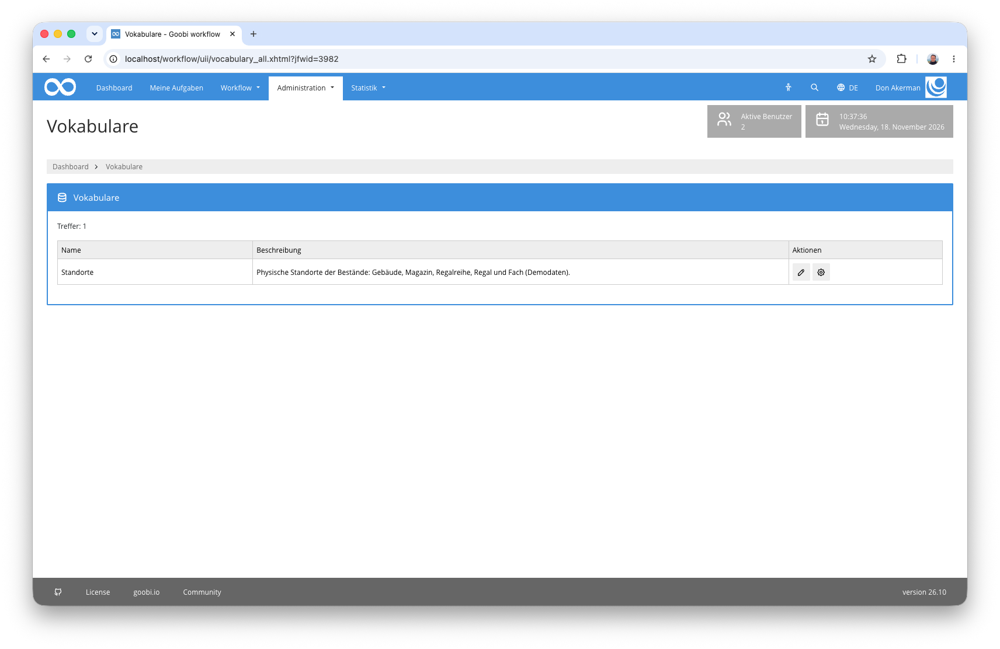

Goobi workflow greift seit Version `24.07` nicht mehr auf eigene, eingebettete Vokabulare zu, sondern spricht über eine REST-Schnittstelle mit dem Vokabularserver. Damit das funktioniert, muss Goobi workflow wissen, wo der Vokabularserver erreichbar ist und mit welchem Token es sich anmelden darf.

## Konfiguration in Goobi workflow
Die Verbindung wird in der Datei `goobi_config.properties` von Goobi workflow eingerichtet. Am einfachsten ist die Angabe einer vollständigen Adresse:

```properties
vocabularyServerAddress=http://localhost:8081
vocabularyServerToken=geheimes-token
```

Alternativ können Rechnername und Port getrennt angegeben werden:

```properties
vocabularyServerHost=localhost
vocabularyServerPort=8081
vocabularyServerToken=geheimes-token
```

| Parameter | Bedeutung |
| :--- | :--- |
| `vocabularyServerAddress` | Vollständige Adresse des Vokabularservers, auch mit `https` und Pfad (z. B. `https://example.com/vocabulary`). Hat Vorrang vor Host und Port. |
| `vocabularyServerHost` | Rechnername des Vokabularservers, wenn keine Adresse angegeben ist. |
| `vocabularyServerPort` | Port des Vokabularservers, wenn keine Adresse angegeben ist. |
| `vocabularyServerToken` | Token, mit dem sich Goobi workflow am Vokabularserver anmeldet. Es muss mit dem Token übereinstimmen, das in der Konfiguration des Vokabularservers festgelegt ist. |

Nach einer Änderung muss Goobi workflow neu gestartet werden.

:::info
Das Token schützt alle schreibenden und lesenden Zugriffe auf den Vokabularserver. Verwenden Sie in produktiven Umgebungen ein langes, zufälliges Token und geben Sie es nicht weiter.
:::

## Verbindung prüfen
Melden Sie sich in Goobi workflow mit einem Konto an, das Vokabulare verwalten darf, und öffnen Sie `Administration` > `Vokabulare`.

- Funktioniert die Verbindung, erscheint die Liste der vorhandenen Vokabulare. Bei einer frischen Installation ist diese Liste noch leer.
- Funktioniert die Verbindung nicht, zeigt Goobi workflow eine rote Fehlermeldung an. Prüfen Sie dann Adresse, Port und Token sowie, ob der Vokabularserver läuft.



Ob der Vokabularserver selbst erreichbar ist, lässt sich auch unabhängig von Goobi workflow prüfen. Der folgende Aufruf liefert die Liste aller Vokabulare als JSON:

```bash
curl -s -H "Authorization: Bearer geheimes-token" "http://localhost:8081/api/v1/vocabularies"
```

Weitere Beispiele für Abfragen finden Sie im Abschnitt [Abfragen über die REST-API](/de/other/vocabulary/integration/rest/).
