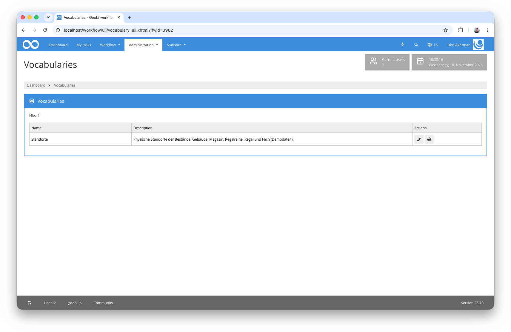

Since version `24.07`, Goobi workflow no longer uses its own embedded vocabularies. Instead, it talks to the vocabulary server through a REST interface. For this to work, Goobi workflow needs to know where the vocabulary server can be reached and which token it may use to authenticate.

## Configuration in Goobi workflow
The connection is configured in the file `goobi_config.properties` of Goobi workflow. The simplest way is to specify a complete address:

```properties
vocabularyServerAddress=http://localhost:8081
vocabularyServerToken=secret-token
```

Alternatively, host name and port can be specified separately:

```properties
vocabularyServerHost=localhost
vocabularyServerPort=8081
vocabularyServerToken=secret-token
```

| Parameter | Meaning |
| :--- | :--- |
| `vocabularyServerAddress` | Complete address of the vocabulary server, also with `https` and a path (e.g. `https://example.com/vocabulary`). Takes precedence over host and port. |
| `vocabularyServerHost` | Host name of the vocabulary server if no address is given. |
| `vocabularyServerPort` | Port of the vocabulary server if no address is given. |
| `vocabularyServerToken` | Token Goobi workflow uses to authenticate against the vocabulary server. It must match the token set in the vocabulary server's configuration. |

Goobi workflow must be restarted after a change.

:::info
The token protects all reading and writing access to the vocabulary server. In production environments, use a long, random token and do not share it.
:::

## Checking the connection
Log in to Goobi workflow with an account that may manage vocabularies and open `Administration` > `Vocabularies`.

- If the connection works, the list of existing vocabularies appears. On a fresh installation this list is still empty.
- If the connection does not work, Goobi workflow shows a red error message. In that case, check address, port and token, and whether the vocabulary server is running.



You can also check whether the vocabulary server itself is reachable, independently of Goobi workflow. The following call returns the list of all vocabularies as JSON:

```bash
curl -s -H "Authorization: Bearer secret-token" "http://localhost:8081/api/v1/vocabularies"
```

More query examples can be found in the section [Queries via the REST API](/en/other/vocabulary/integration/rest/).
