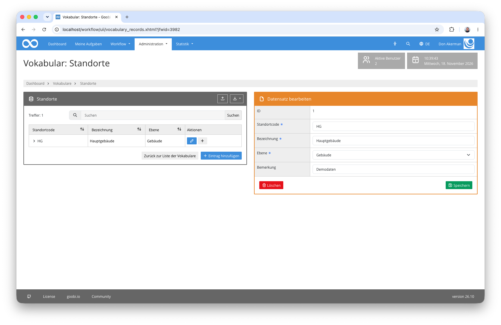
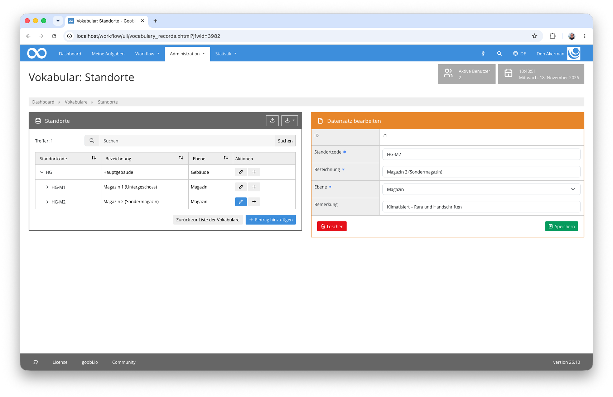
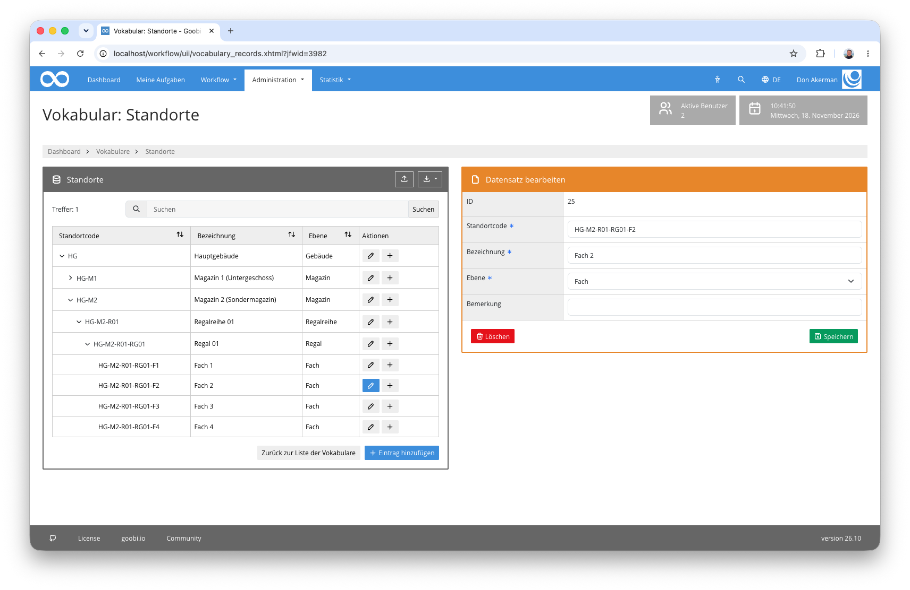

Feldtypen, Schemata und Vokabulare selbst werden über die REST-API des Vokabularservers angelegt (siehe [Anleitung zur Erstellung von Vokabularen](/de/other/vocabulary/data/creation/)). Die Datensätze eines Vokabulars lassen sich danach bequem in Goobi workflow pflegen. Als durchgehendes Beispiel dient auf dieser Seite ein hierarchisches Vokabular `Standorte`, das die Aufstellung von Beständen abbildet: Gebäude, Magazin, Regalreihe, Regal und Fach.

## Übersicht der Vokabulare
Unter `Administration` > `Vokabulare` listet Goobi workflow alle Vokabulare des Vokabularservers mit Namen und Beschreibung auf. Über das Stift-Symbol in der Spalte `Aktionen` öffnen Sie die Datensätze eines Vokabulars.



## Datensätze ansehen und bearbeiten
Die Seite eines Vokabulars ist zweigeteilt. Links steht die Liste der Datensätze, rechts das Formular des gerade gewählten Datensatzes.

- Die Spalten der Liste sind die Felder, die im Vokabularschema als Titelfeld (`titleField`) markiert sind.
- Über das Suchfeld oberhalb der Liste lassen sich Datensätze finden.
- Das Formular zeigt alle Felder des Schemas. Pflichtfelder sind mit einem Stern markiert. Felder mit festen Auswahlwerten erscheinen als Auswahlliste.
- Mit `Speichern` werden Änderungen übernommen, mit `Löschen` wird der Datensatz entfernt.



## Hierarchische Vokabulare
Ist im Vokabularschema `hierarchicalRecords` aktiviert, zeigt Goobi workflow die Datensätze als Baum.

- Zunächst sind nur die Datensätze der obersten Ebene zu sehen. Über den Pfeil vor einem Eintrag klappen Sie dessen untergeordnete Datensätze auf.
- Über das Plus-Symbol in der Spalte `Aktionen` legen Sie einen neuen Datensatz unterhalb des gewählten Eintrags an.
- Über `Eintrag hinzufügen` unterhalb der Liste entsteht ein neuer Datensatz auf der obersten Ebene.



:::info
Ist ein Feld im Schema als eindeutig (`unique`) markiert, darf jeder Wert in diesem Feld im ganzen Vokabular nur einmal vorkommen, auch über verschiedene Ebenen hinweg. Für ein Standortvokabular bietet sich daher ein eindeutiger Standortcode als Haupteintrag an, etwa `HG-M1-R02-RG01-F3`, während Bezeichnungen wie `Fach 3` mehrfach vorkommen dürfen.
:::

## Import und Export
Oben rechts auf der Seite eines Vokabulars befinden sich zwei Schaltflächen:

- Über das Upload-Symbol werden Datensätze aus einer Datei importiert, zum Beispiel aus einer CSV- oder Excel-Datei.
- Über das Download-Symbol wird das Vokabular in verschiedenen Formaten exportiert.

Für einen Import muss die erste Zeile der Datei die Feldnamen des Schemas enthalten. Bei hierarchischen Vokabularen kommen die Spalten `ID` und `Parent-ID` hinzu. Die IDs gelten nur innerhalb der Datei und verknüpfen die Zeilen miteinander. Übergeordnete Datensätze müssen dabei vor ihren untergeordneten stehen. Ein Ausschnitt für das Vokabular `Standorte`:

```csv
ID,Parent-ID,Standortcode,Bezeichnung,Ebene,Bemerkung
1,,HG,Hauptgebäude,Gebäude,
2,1,HG-M1,Magazin 1 (Untergeschoss),Magazin,Allgemeiner Bestand
3,2,HG-M1-R01,Regalreihe 01,Regalreihe,Fahrregalanlage
4,3,HG-M1-R01-RG01,Regal 01,Regal,
5,4,HG-M1-R01-RG01-F1,Fach 1,Fach,
```

:::info
Der CSV-Import trennt die Spalten an jedem Komma, auch wenn ein Wert in Anführungszeichen steht. Werte dürfen daher keine Kommas enthalten. Für Werte mit Kommas eignet sich der Import aus einer Excel-Datei.
:::
