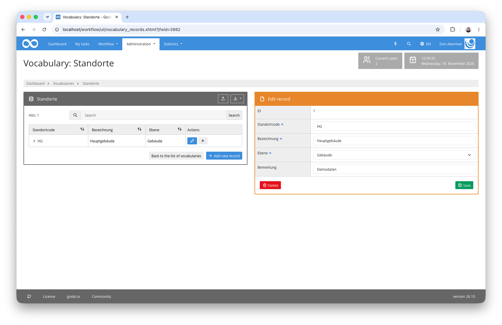
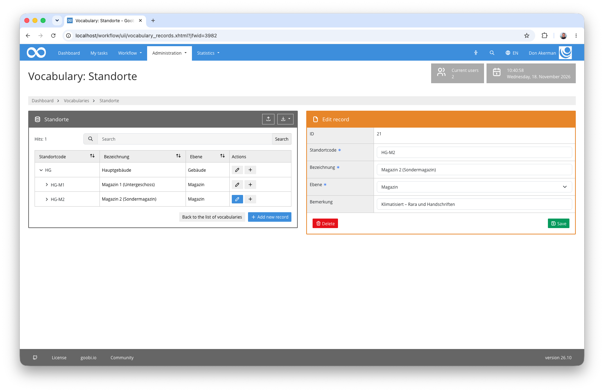
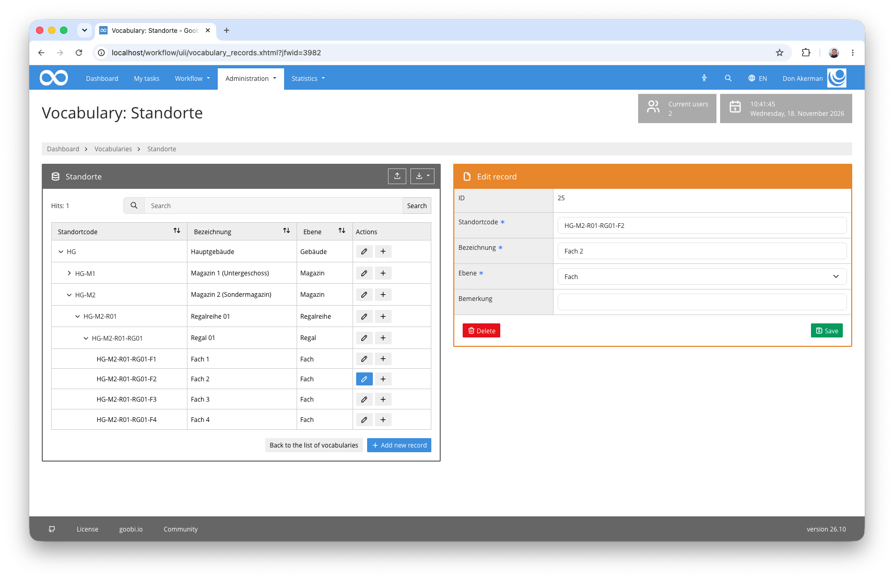

Field types, schemas and the vocabularies themselves are created through the REST API of the vocabulary server (see [Guide to creating vocabularies](/en/other/vocabulary/data/creation/)). Afterwards, the records of a vocabulary can be maintained conveniently in Goobi workflow. Throughout this page, a hierarchical vocabulary `Locations` serves as an example. It models where holdings are stored: building, stack room, shelf row, shelf and compartment.

## Overview of vocabularies
Under `Administration` > `Vocabularies`, Goobi workflow lists all vocabularies of the vocabulary server with their name and description. The pencil icon in the `Actions` column opens the records of a vocabulary.



## Viewing and editing records
The page of a vocabulary is split in two. On the left is the list of records, on the right the form of the currently selected record.

- The columns of the list are the fields marked as title fields (`titleField`) in the vocabulary schema.
- The search field above the list helps to find records.
- The form shows all fields of the schema. Required fields are marked with an asterisk. Fields with fixed selectable values appear as a drop-down list.
- `Save` applies the changes, `Delete` removes the record.



## Hierarchical vocabularies
If `hierarchicalRecords` is enabled in the vocabulary schema, Goobi workflow shows the records as a tree.

- At first, only the records of the top level are visible. The arrow in front of an entry expands its child records.
- The plus icon in the `Actions` column creates a new record below the selected entry.
- `Add entry` below the list creates a new record on the top level.



:::info
If a field is marked as unique (`unique`) in the schema, each value of this field may occur only once in the whole vocabulary, across all levels. For a location vocabulary, a unique location code such as `HG-M1-R02-RG01-F3` is therefore a good main entry, while labels like `Compartment 3` may occur many times.
:::

## Import and export
At the top right of a vocabulary's page there are two buttons:

- The upload icon imports records from a file, for example a CSV or Excel file.
- The download icon exports the vocabulary in various formats.

For an import, the first row of the file must contain the field names of the schema. Hierarchical vocabularies additionally need the columns `ID` and `Parent-ID`. The IDs are only valid within the file and link the rows to each other. Parent records must come before their children. An excerpt for the `Locations` vocabulary:

```csv
ID,Parent-ID,Code,Label,Level,Note
1,,HG,Main building,Building,
2,1,HG-M1,Stack room 1 (basement),Stack room,General holdings
3,2,HG-M1-R01,Shelf row 01,Shelf row,Mobile shelving
4,3,HG-M1-R01-RG01,Shelf 01,Shelf,
5,4,HG-M1-R01-RG01-F1,Compartment 1,Compartment,
```

:::info
The CSV import splits columns at every comma, even if a value is enclosed in quotes. Values must therefore not contain commas. For values with commas, use the import from an Excel file instead.
:::
