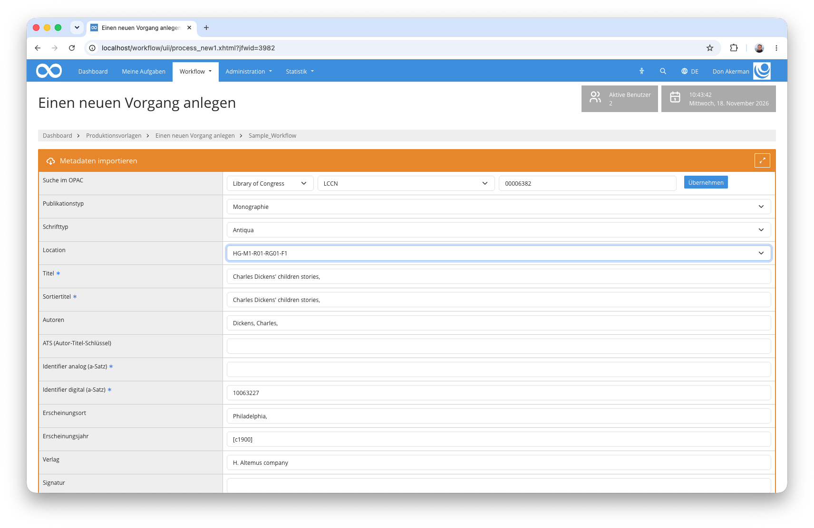
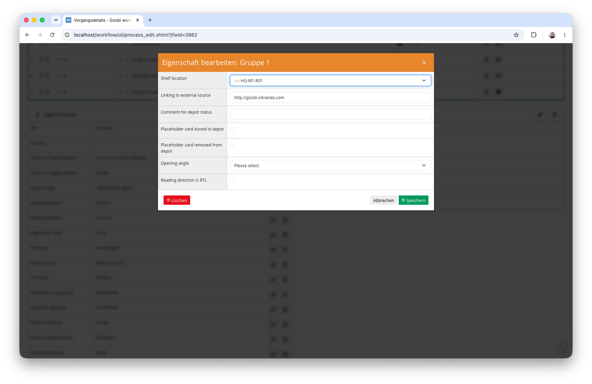

Vokabulare lassen sich an mehreren Stellen in Goobi workflow als Auswahlliste einsetzen. Eingebunden werden sie jeweils über ihren Namen. Diese Seite zeigt die drei häufigsten Stellen am Beispiel des hierarchischen Vokabulars `Standorte` (siehe [Vokabulare in Goobi verwalten](/de/other/vocabulary/integration/administration/)).

| Stelle | Konfigurationsdatei | Zweck |
| :--- | :--- | :--- |
| Anlegen von Vorgängen | `goobi_projects.xml` | Auswahl eines Werts beim Anlegen eines neuen Vorgangs |
| Vorgangseigenschaften | `goobi_processProperties.xml` | Auswahl eines Werts in Eigenschaften, die in Arbeitsschritten gepflegt werden |
| Metadateneditor | `goobi_metadataDisplayRules.xml` | Auswahl eines Werts für ein Metadatum |

:::info
Der Name des Vokabulars muss in der Konfiguration genau so geschrieben werden wie im Vokabularserver, einschließlich Groß- und Kleinschreibung.
:::

## Beim Anlegen von Vorgängen
In der Datei `goobi_projects.xml` wird ein Eingabefeld der Vorgangsanlage mit dem Parameter `vocabulary` an ein Vokabular gebunden. Statt eines Textfelds erscheint dann eine Auswahlliste mit den Haupteinträgen der Datensätze, alphabetisch sortiert. Gespeichert wird der Haupteintrag des gewählten Datensatzes.

```xml
<item property="true" multiselect="false" required="false" vocabulary="Standorte" vocabulary-filter="Ebene=Fach">Standort</item>
```

| Parameter | Bedeutung |
| :--- | :--- |
| `vocabulary` | Name des Vokabulars, dessen Datensätze angeboten werden. |
| `vocabulary-filter` | Optionaler Filter in der Form `Feldname=Wert`. Es werden nur Datensätze angeboten, deren Feld den Wert enthält. Der Feldname ist der Name des Felds im Vokabularschema. |
| `property` | Mit `true` wird der gewählte Wert als Vorgangseigenschaft gespeichert. |

Bei hierarchischen Vokabularen durchsucht der Filter den ganzen Baum. Im Beispiel liefert `Ebene=Fach` alle Fächer aus allen Magazinen und Regalen als flache Liste. Ohne Filter würden nur die Datensätze der obersten Ebene angeboten.

:::info
Der Filter prüft, ob der Feldwert den angegebenen Text enthält, nicht ob er genau gleich ist. `Standortcode=HG-M2` findet daher auch alle Datensätze unterhalb von `HG-M2`.
:::



## In Vorgangseigenschaften
Vorgangseigenschaften werden in der Datei `goobi_processProperties.xml` definiert. Mit dem Typ `vocabularyreference` wählt der Nutzer genau einen Datensatz aus, mit `vocabularymultireference` mehrere. Das Element `vocabulary` nennt das Vokabular.

```xml
<property name="Standort" container="Aufbewahrung">
    <project>*</project>
    <showStep name="Bestand ausheben" access="write" />
    <showProcessGroup access="write" />
    <type>vocabularyreference</type>
    <vocabulary>Standorte</vocabulary>
</property>
```

Die Auswahlliste enthält alle Datensätze des Vokabulars mit ihrem Haupteintrag. Bei hierarchischen Vokabularen erscheint der ganze Baum, wobei untergeordnete Datensätze durch vorangestellte Striche eingerückt sind. Ein Filter wie bei der Vorgangsanlage ist hier nicht vorgesehen.

Gespeichert wird die ID des gewählten Datensatzes, angezeigt wird sein Haupteintrag. Das unterscheidet sich von der Vorgangsanlage, die den Haupteintrag selbst speichert. Wer die Eigenschaft später auswertet, etwa in Skripten oder Exporten, erhält also eine Datensatz-ID, über die sich der Datensatz per REST-API abrufen lässt.



## Im Metadateneditor
Im Metadateneditor wird ein Metadatum in der Datei `goobi_metadataDisplayRules.xml` an ein Vokabular gebunden. Dafür gibt es zwei Darstellungen:

- `vocabularyList` zeigt die Datensätze als Auswahlliste. Das funktioniert nur mit Vokabularen ohne Hierarchie.
- `vocabularySearch` öffnet einen Suchdialog. Das funktioniert auch mit hierarchischen und großen Vokabularen.

### Suchdialog
Für das hierarchische Vokabular `Standorte` ist der Suchdialog die passende Wahl:

```xml
<vocabularySearch ref="PhysicalLocation">
    <source>Standorte</source>
    <field>Standortcode; Bezeichnung; Ebene</field>
</vocabularySearch>
```

Das Attribut `ref` nennt das Metadatum aus dem Regelsatz, `source` das Vokabular. `field` legt fest, in welchen Feldern gesucht werden kann. Die Feldnamen werden durch Semikolon getrennt.

Neben dem Metadatum erscheint ein Symbol `V`, das den Suchdialog öffnet. Dort wählt der Nutzer ein Suchfeld, gibt einen Suchbegriff ein und übernimmt einen Treffer. Die Trefferliste zeigt die Titelfelder des Schemas, bei hierarchischen Vokabularen zusätzlich den Pfad im Baum, etwa `HG ▸ HG-M1 ▸ HG-M1-R01 ▸ HG-M1-R01-RG01`. Übernommen wird der Haupteintrag des Datensatzes als Wert, die Adresse des Datensatzes im Vokabularserver als Normdaten-URI (z. B. `http://localhost:8081/api/v1/records/7`).

:::info
Die Normdaten-URI wird aus der in `goobi_config.properties` eingetragenen Adresse des Vokabularservers gebildet. Ist dort eine nur intern erreichbare Adresse eingetragen, ist auch die URI in exportierten Metadaten nur intern auflösbar.
:::

### Auswahlliste
Für Vokabulare ohne Hierarchie genügt meist eine einfache Auswahlliste:

```xml
<vocabularyList ref="DocLanguage">
    <source>Sprachen</source>
</vocabularyList>
```

Ist das Vokabular hierarchisch, bleibt die Liste leer und Goobi workflow meldet, dass das Vokabular nicht in eine einfache Liste geladen werden kann.

Weitere Möglichkeiten, etwa das Einschränken der Liste über `field`, beschreibt die Dokumentation der Datei `goobi_metadataDisplayRules.xml` im Handbuch von Goobi workflow.

## Weitere Einsatzmöglichkeiten
Darüber hinaus greifen verschiedene Plugins auf Vokabulare zu, zum Beispiel um Metadaten automatisch anzureichern oder Werte zu ersetzen. Die jeweilige Konfiguration ist in der Dokumentation des Plugins beschrieben.
