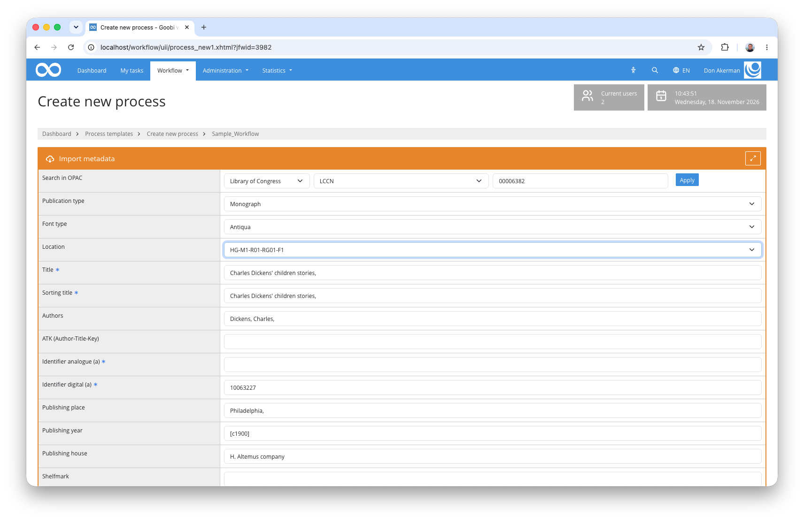
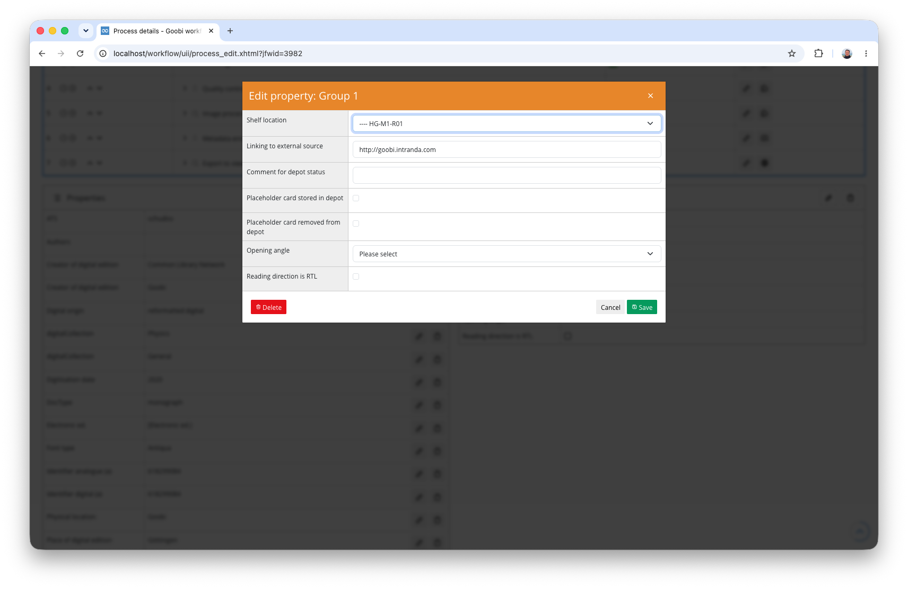

Vocabularies can be used as selection lists in several places in Goobi workflow. In each case they are referenced by their name. This page shows the three most common places, using the hierarchical vocabulary `Locations` as an example (see [Managing vocabularies in Goobi](/en/other/vocabulary/integration/administration/)).

| Place | Configuration file | Purpose |
| :--- | :--- | :--- |
| Process creation | `goobi_projects.xml` | Selecting a value when creating a new process |
| Process properties | `goobi_processProperties.xml` | Selecting a value in properties maintained in workflow steps |
| Metadata editor | `goobi_metadataDisplayRules.xml` | Selecting a value for a metadata field |

:::info
The vocabulary name must be written in the configuration exactly as on the vocabulary server, including upper and lower case.
:::

## When creating processes
In the file `goobi_projects.xml`, an input field of the process creation form is bound to a vocabulary with the parameter `vocabulary`. Instead of a text field, a selection list with the main entries of the records appears, sorted alphabetically. The main entry of the selected record is stored.

```xml
<item property="true" multiselect="false" required="false" vocabulary="Locations" vocabulary-filter="Level=Compartment">Location</item>
```

| Parameter | Meaning |
| :--- | :--- |
| `vocabulary` | Name of the vocabulary whose records are offered. |
| `vocabulary-filter` | Optional filter in the form `fieldName=value`. Only records whose field contains the value are offered. The field name is the name of the field in the vocabulary schema. |
| `property` | With `true`, the selected value is stored as a process property. |

For hierarchical vocabularies, the filter searches the whole tree. In the example, `Level=Compartment` returns all compartments from all stack rooms and shelves as a flat list. Without a filter, only the records of the top level would be offered.

:::info
The filter checks whether the field value contains the given text, not whether it is exactly equal. `Code=HG-M2` therefore also finds all records below `HG-M2`.
:::



## In process properties
Process properties are defined in the file `goobi_processProperties.xml`. With the type `vocabularyreference` the user selects exactly one record, with `vocabularymultireference` several. The element `vocabulary` names the vocabulary.

```xml
<property name="Location" container="Storage">
    <project>*</project>
    <showStep name="Retrieve holdings" access="write" />
    <showProcessGroup access="write" />
    <type>vocabularyreference</type>
    <vocabulary>Locations</vocabulary>
</property>
```

The selection list contains all records of the vocabulary with their main entry. For hierarchical vocabularies the whole tree appears, with child records indented by leading dashes. A filter as in process creation is not available here.

The ID of the selected record is stored, its main entry is displayed. This differs from process creation, which stores the main entry itself. Anyone evaluating the property later, for example in scripts or exports, therefore gets a record ID that can be used to retrieve the record through the REST API.



## In the metadata editor
In the metadata editor, a metadata field is bound to a vocabulary in the file `goobi_metadataDisplayRules.xml`. There are two ways of displaying it:

- `vocabularyList` shows the records as a selection list. This only works with vocabularies without a hierarchy.
- `vocabularySearch` opens a search dialog. This also works with hierarchical and large vocabularies.

### Search dialog
For the hierarchical vocabulary `Locations`, the search dialog is the right choice:

```xml
<vocabularySearch ref="PhysicalLocation">
    <source>Locations</source>
    <field>Code; Label; Level</field>
</vocabularySearch>
```

The attribute `ref` names the metadata field from the ruleset, `source` the vocabulary. `field` defines in which fields the user can search. Field names are separated by semicolons.

Next to the metadata field, a `V` icon appears that opens the search dialog. There the user selects a search field, enters a search term and takes over a hit. The list of hits shows the title fields of the schema and, for hierarchical vocabularies, also the path in the tree, such as `HG ▸ HG-M1 ▸ HG-M1-R01 ▸ HG-M1-R01-RG01`. The main entry of the record is taken over as the value, and the record's address on the vocabulary server as the authority URI (e.g. `http://localhost:8081/api/v1/records/7`).

:::info
The authority URI is built from the vocabulary server address configured in `goobi_config.properties`. If only an internal address is configured there, the URI in exported metadata can also only be resolved internally.
:::

### Selection list
For vocabularies without a hierarchy, a simple selection list is usually enough:

```xml
<vocabularyList ref="DocLanguage">
    <source>Languages</source>
</vocabularyList>
```

If the vocabulary is hierarchical, the list stays empty and Goobi workflow reports that the vocabulary cannot be loaded into a flat list.

Further options, such as restricting the list with `field`, are described in the documentation of the file `goobi_metadataDisplayRules.xml` in the Goobi workflow manual.

## Further uses
In addition, several plugins access vocabularies, for example to enrich metadata automatically or to replace values. The respective configuration is described in the documentation of the plugin.
